<div align="center">

# 🔬 RCA Copilot

### AI-assisted Root Cause Analysis for API (pharmaceutical) manufacturing

Drop in an incident report, an email, or a shift log. The Copilot drafts the investigation —
facts, **5 Whys**, **fishbone**, root-cause **hypotheses**, **missing evidence** and **CAPA** — with every
value traced back to the source document, and leaves the decisions to people.


`Deviation (context)  →  Root Cause Analysis (this module)  →  CAPA   + QA review & audit trail`

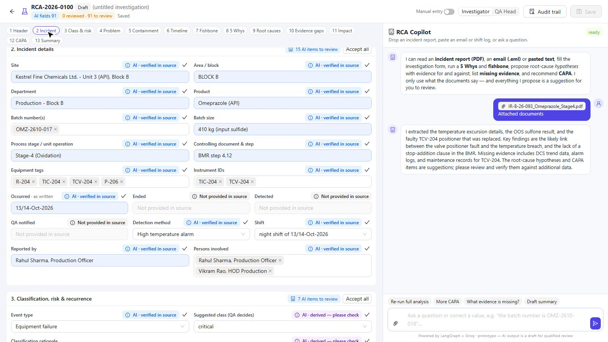

</div>

> **Prototype, not a validated system.** RCA Copilot is a *GMP-inspired investigation prototype*. It is not a validated
> GMP / 21 CFR Part 11 system. The role switch is demo-only (no authentication) and the QA "confirm / approve" actions are
> review confirmations, **not** legally valid electronic signatures. All AI output is a draft for qualified review.
> All people, companies, batches and documents in this repository are fictional.

---

## Contents
[Why](#why-this-exists) · [Tour](#product-tour) · [Principles](#design-principles) · [Architecture](#architecture) ·
[LangGraph workflow](#the-langgraph-workflow) · [Data model](#data-model) · [Requirements matrix](#requirements-matrix) ·
[Run it](#run-it) · [Demo documents](#demo-documents) · [Tests](#tests) · [Project layout](#project-layout) ·
[Decisions and limits](#decisions-and-known-limits)

## Why this exists
A root cause analysis is slow because the investigator has to turn a messy report into a structured, defensible record:
what happened, what the limits were, which causes are plausible, what evidence is still missing, and what to do about it.
Generic LLM form-fillers make this *worse* by sounding confident about things the document never said.

RCA Copilot is built around the opposite stance:

* the AI does the typing and the first-pass structuring, **fast**;
* every extracted value carries a **verbatim quote** that is checked against the source;
* every root cause is a **hypothesis** with supporting *and* contradicting evidence, assumptions, missing evidence and a test that would confirm or refute it;
* **people** review, edit and confirm — the AI can never confirm a cause, approve, or decide a batch disposition.

## Product tour

### 1 · Start from the list — past investigations feed the recurrence check
Three closed (fictional) investigations are seeded. They are not decoration: the Copilot searches them for recurrences.

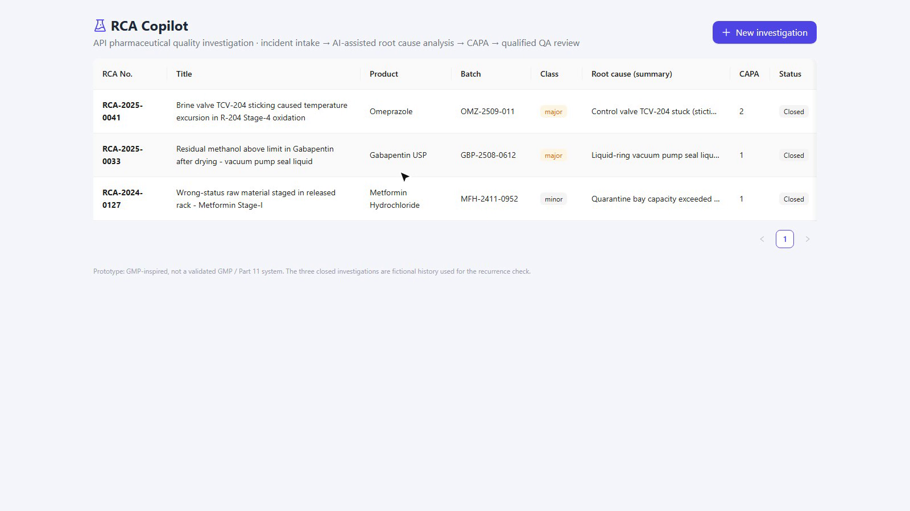

### 2 · The form starts empty; the Copilot is the way in
Fields read **Awaiting AI extraction…** until a document arrives. Drop a PDF / `.eml` / `.docx` / `.txt`, paste text, or click a sample.

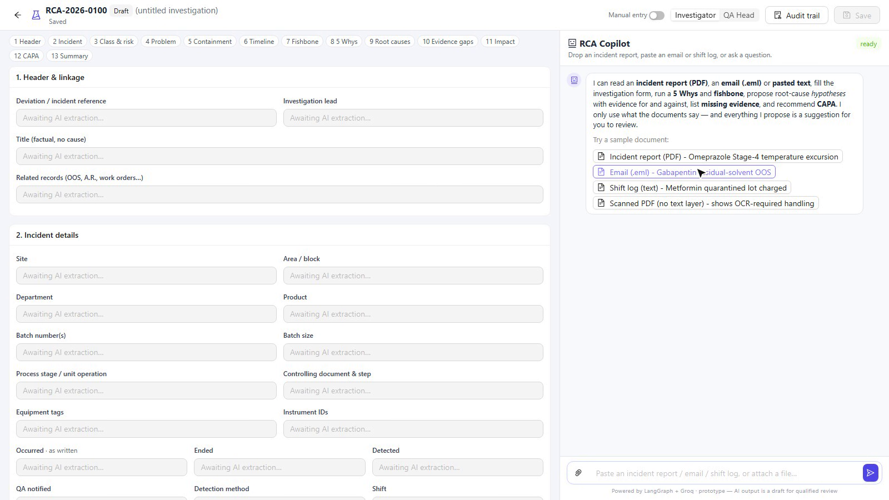

### 3 · A LangGraph run streams into the form
The Copilot shows each step (with the model used and counts) as it completes; the form scrolls to the section being filled. On Groq's free tier the app paces requests per model and tells you when it is waiting for the rate-limit window.

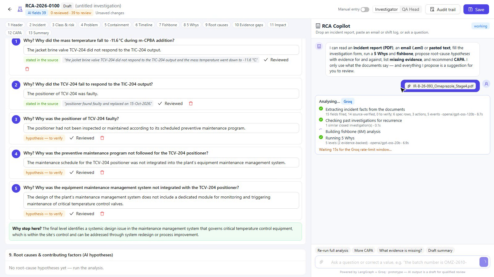

### 4 · Provenance on every field
Blue = *AI · verified in source*, purple = *derived — please check*, amber = *not found in source — verify*, grey = *Not provided in source*. Hover a badge for the exact quote, model and confidence. Anything a person edits is marked *Edited by you* and is never overwritten by a later AI run.


### 5 · Requirement vs actual is computed in code, not by the model
The model extracts the limit and the result; whether a result is *within* or *OUTSIDE* the limit is evaluated deterministically (it understands `NMT`, `NLT` and ranges such as `98.0-102.0 %`).

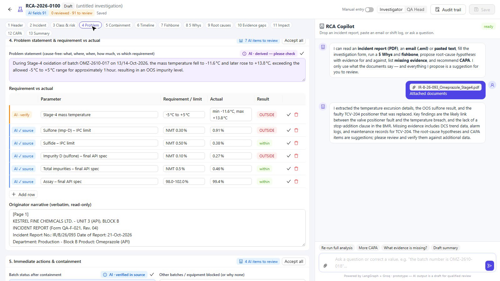

### 6 · Recurrence check against closed investigations
Postgres full-text search plus shared-equipment / same-product filtering. A repeat of a problem whose earlier CAPA "worked" is a strong signal that the CAPA was ineffective — so the suggested class is escalated.

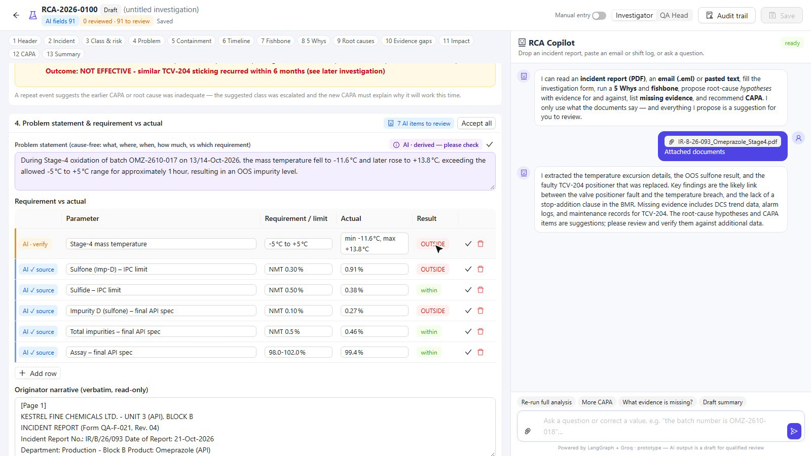

### 7 · 5 Whys and fishbone (6M)
Each *why* is tagged **evidence-backed** or **hypothesis to verify**, and the chain explains why it stopped. The fishbone covers all six categories — Man, Machine, Method, Material, Measurement, Environment — in a neutral order, coloured by disposition.

<table><tr>
<td>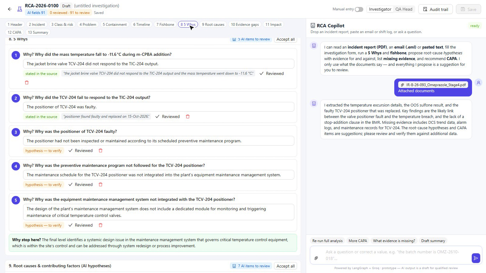</td>
<td>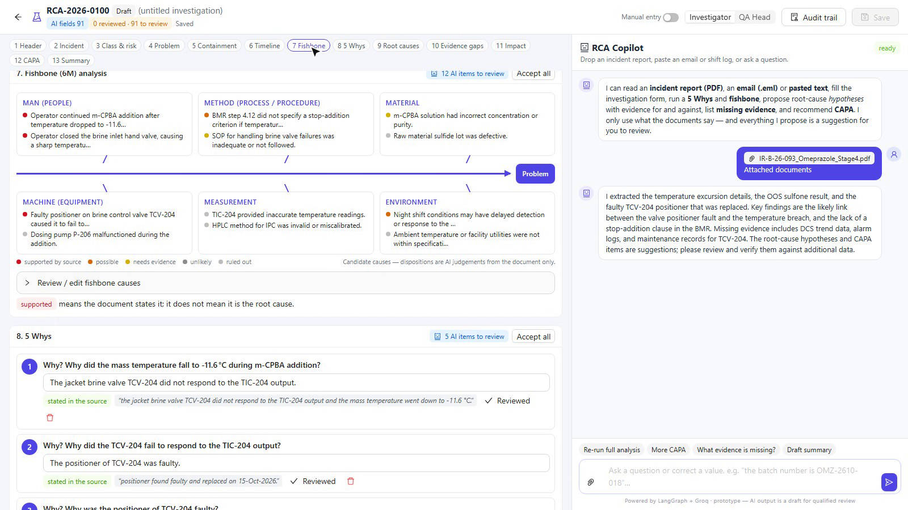</td>
</tr></table>

### 8 · Root causes are hypotheses, with mandatory evidence blocks
Each carries **supporting evidence (quoted)**, **contradicting evidence**, **assumptions**, **missing evidence** and a **verification test**. A quote that exists in the document proves the model *read* it — not that its causal reading is right.

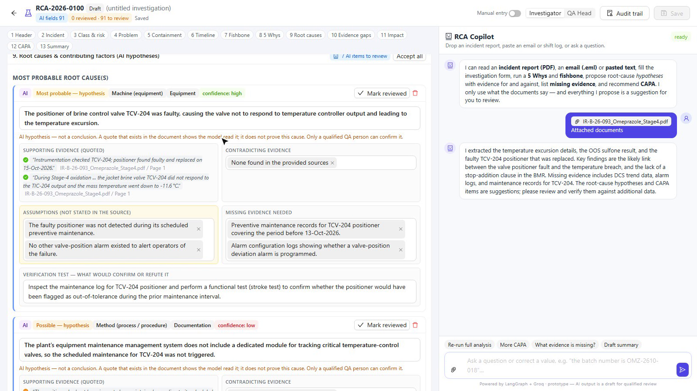

### 9 · Missing evidence and CAPA
Gaps are grouped by evidence area (Equipment, Process, Materials, Analytical, Personnel, Environment, Documentation, Historical). CAPA is split into **Correction / Corrective / Preventive**, each with rationale, control strength, owner, due date and an **effectiveness check**. There is no "retrain the operator" shortcut: training-only CAPA is flagged.

<table><tr>
<td>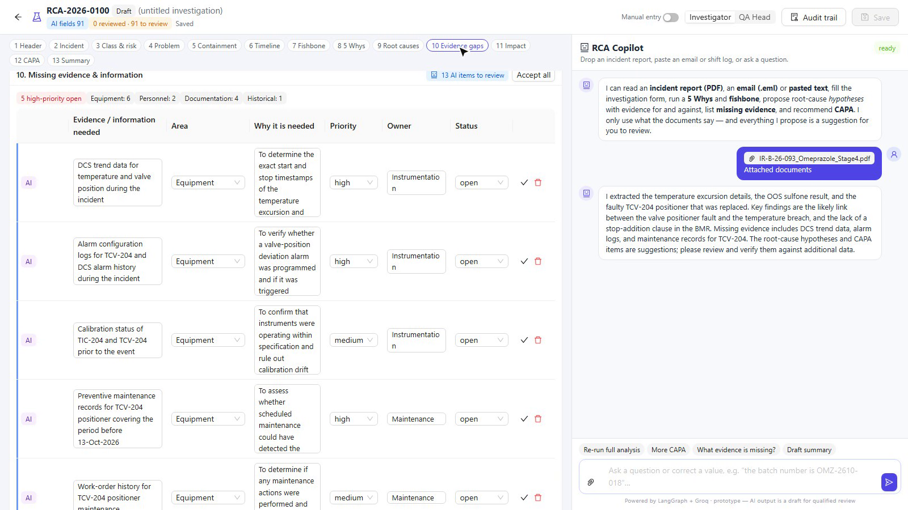</td>
<td>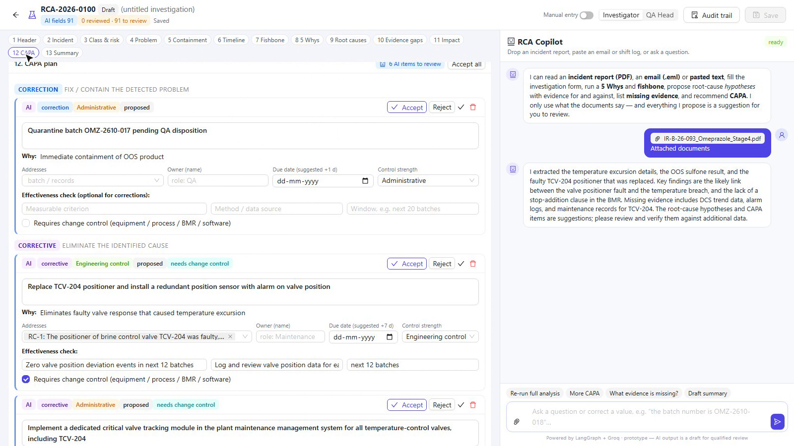</td>
</tr></table>

### 10 · QA confirmation and the audit trail
Only the QA role can confirm a root cause, and only with a written rationale. The audit trail separates what the **AI applied** from what **people edited or confirmed**.

<table><tr>
<td>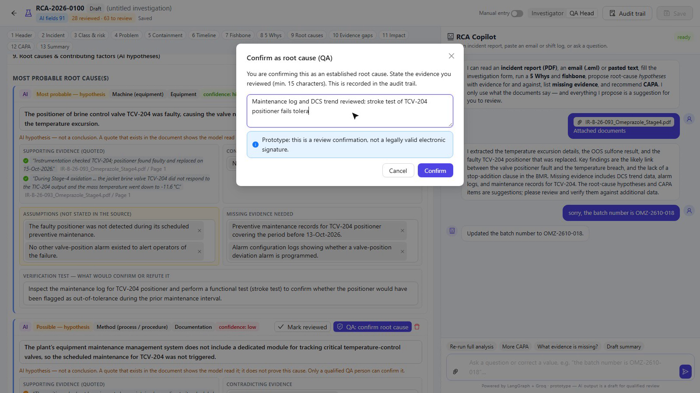</td>
<td>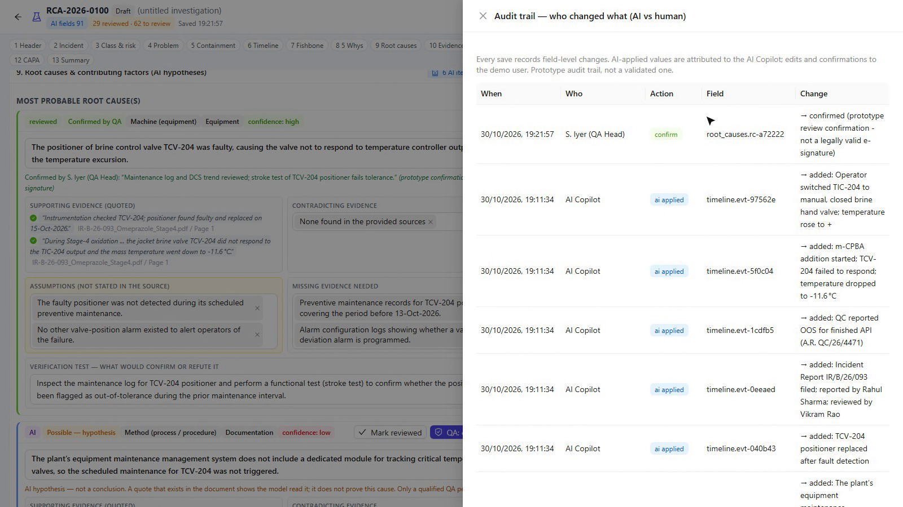</td>
</tr></table>

### 11 · No guessing from unreadable files
A scanned, image-only PDF has no extractable text. The Copilot says so, asks for OCR or pasted text, and **stops** rather than inventing an analysis.

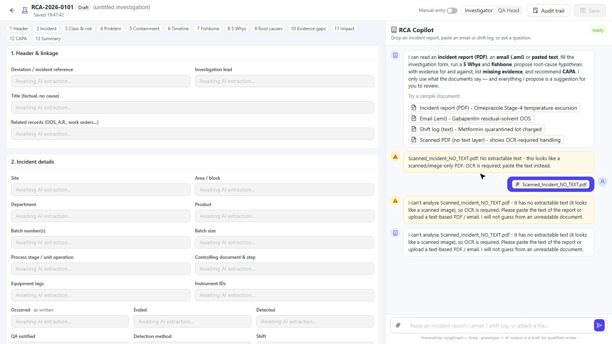

## Design principles

| Principle | How it is enforced |
|---|---|
| **AI drafts, humans decide** | Certainty the AI may propose is `possible` / `most_probable`. `confirmed` needs the QA role, a ≥ 15-character rationale and recorded evidence. The AI cannot approve, close or set disposition. |
| **Every value is grounded** | The model returns `{value, quote, confidence}`. The backend fuzzy-matches the quote against the source and checks that numbers in the value appear in the source. Unverifiable values are flagged amber, not silently accepted. |
| **Quote ≠ causal proof** | Causes are always hypotheses. Schemas *require* supporting evidence, contradicting evidence, assumptions, missing evidence and a verification test; a repair pass re-asks the model when any block is empty. |
| **AI never overwrites people** | AI output is applied in *fill* mode; edited or reviewed fields and items are skipped (and the run reports how many). Chat corrections use *force* mode and are attributed to the user. |
| **Guardrails from inspection findings** | "Human error" / retraining is not accepted as a root cause or sole CAPA; the fishbone covers all 6M; every root cause needs a corrective action; effectiveness checks are mandatory; other batches must be assessed. |
| **Honest about what it can't read** | Scanned PDFs are detected and blocked with an explicit OCR-required message. |
| **Failure is visible** | A missing key, a Groq outage or a rate-limit wait produces a clear message; a circuit breaker stops the remaining steps after the first hard failure. |

## Architecture

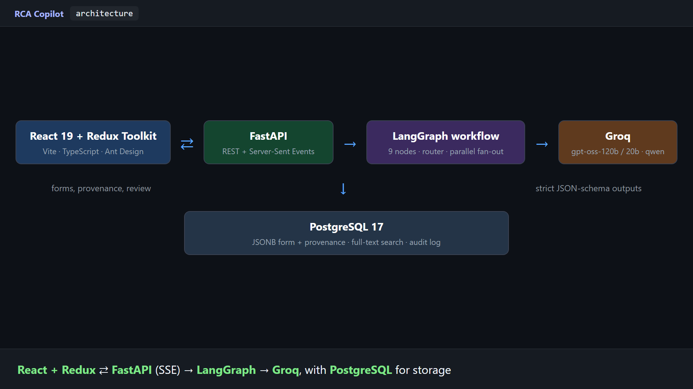

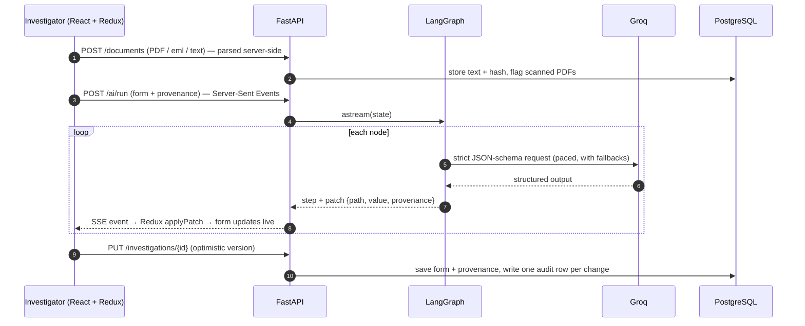

**Notes**

* The browser's built-in `EventSource` cannot POST, so the client reads the stream with `fetch` + `eventsource-parser`.
* The graph runs in a background task feeding a queue, so closing the tab does not abort an analysis half-way; the result is still persisted.
* The form and provenance are stored as `JSONB`; AI output is a stream of path-addressed **patches**, which is what makes "never overwrite human edits" and per-field audit rows straightforward.

## The LangGraph workflow

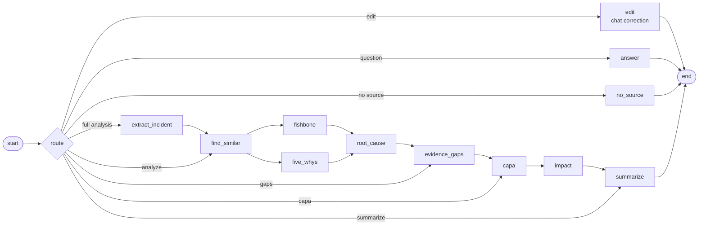

* `fishbone` and `five_whys` run **in parallel** (fan-out from `find_similar`) and **join** at `root_cause`.
* Intent comes from the UI's quick-action chips; otherwise a fast model classifies the message. Attaching a document with no message means a full analysis.
* A `skippable` wrapper plus a run-level circuit breaker report one clear warning on an LLM outage and skip the remaining nodes.
* Chat corrections produce a validated, structured edit plan (not free-form writes) and a deterministic diff reply, e.g. *"Batch OMZ-2610-017 → OMZ-2610-018"*.

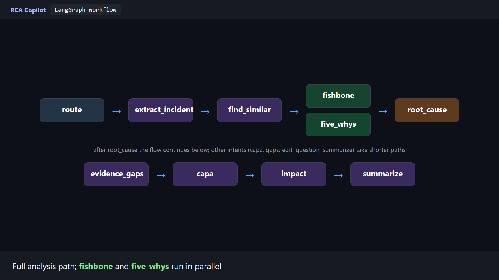

### Groq models — and why not the ones named in the challenge brief
Checked against Groq's documentation on 2026-10-29: `gemma2-9b-it` was shut down on 2025-10-08, and `llama-3.3-70b-versatile` /
`llama-3.1-8b-instant` were shut down for Free/Developer organisations on 2026-08-16. The app therefore uses
`openai/gpt-oss-120b` (analysis, strict JSON schema), `openai/gpt-oss-20b` (routing and light steps) and `qwen/qwen3.8-27b`
(fallback, best-effort schema). IDs live in `backend/.env`; `backend/scripts/groq_check.py` verifies what **your** key can use.

The LLM layer (`backend/app/ai/llm.py`) provides strict structured output with all-required / nullable schemas, a per-model token
pacer, automatic fallback on `429`, one repair retry, and an optional validation callback (used, for example, to reject an
"all lists empty" extraction).

## Data model

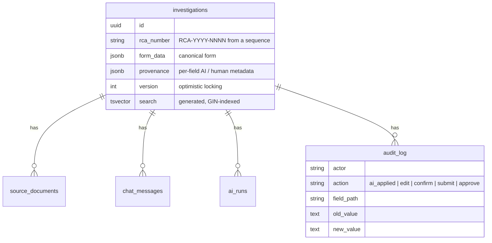

Saving is a transactional version bump plus a diff of the old and new form, written as one audit row per change and tagged
*AI-applied* or *edited by a person*. Added or removed list items collapse into a single audit row.

## Requirements matrix

| Challenge requirement | Where it lives |
|---|---|
| Accept a PDF, pasted text or an email | `services/parsing.py` (pdfplumber text + tables, stdlib `email` incl. attachments, python-docx, pasted-email header detection) |
| AI extracts and populates the form through an AI panel | `ai/nodes/extract.py` → patches → `copilotSlice` / `investigationSlice`; the form starts read-only |
| 5 Whys and fishbone | `ai/nodes/analysis.py` (`five_whys`, `fishbone`), `Fishbone.tsx`, `FiveWhys.tsx` |
| Root causes and contributing factors | `root_cause` node, `RootCauses.tsx`; evidence blocks mandatory |
| Highlight missing evidence | `evidence_gaps` node, grouped by evidence area; plus `not provided in source` markers on fields |
| CAPA recommendations with explanation | `capa` node: type, rationale, strength, owner, due date, effectiveness check |
| User review / edit before saving | field-level edit, *Mark reviewed*, *Accept all*, readiness gates |
| AI causes are suggestions until a qualified person confirms | certainty cap + QA-gated confirmation with rationale (`services/gates.py`, `api/investigations.py`) |
| React + Redux | React 19, Redux Toolkit slices + thunks |
| Python + FastAPI | FastAPI 0.162, SSE streaming |
| LangGraph + Groq | `ai/graph.py`, `ai/llm.py` |
| PostgreSQL | SQLAlchemy 2 async + asyncpg, JSONB, full-text search |

## Run it

**Requirements:** Python 3.12, Node 24, PostgreSQL 17 (the repo's scripts use a portable build in `.local/`, port **5433**, no admin rights needed), and a Groq API key.

```powershell
# 1. backend/.env  (never commit it — it is git-ignored)
#    DATABASE_URL=postgresql+asyncpg://postgres:<password>@127.0.0.1:5433/rca
#    GROQ_API_KEY=gsk_...
#    LLM_MODE=live

# 2. start Postgres, the API (:8000) and the UI (:5173)
powershell scripts\dev.ps1

# 3. optional: verify the Groq models and your real rate limits first
backend\.venv\Scripts\python backend\scripts\groq_check.py
```

Open <http://127.0.0.1:5173> (API docs at <http://127.0.0.1:8000/docs>). Stop the database with `powershell scripts\db-stop.ps1`.

**Offline UI test (no AI call):** set `LLM_MODE=fixture` in `backend/.env`. The Omeprazole sample returns canned output and the UI labels the run *offline dev fixture*.

**Free-tier note:** Groq allows roughly 8 K tokens per minute *per model*. A full analysis makes 9–11 small calls and takes about **2–3 minutes** on the free tier; the app paces calls per model, falls back across models on `429`, and shows when it is waiting for the rate-limit window.

## Demo documents
All fictional, generated by `samples/generate_samples.py`. The Copilot offers them as one-click samples.

| File | Format | Story |
|---|---|---|
| `IR-B-26-093_Omeprazole_Stage4.pdf` | PDF incident report | m-CPBA oxidation temperature excursion; brine valve TCV-204; sulfone Imp-D out of specification; a recurrence of an earlier case |
| `OOS_Gabapentin_GBP-26-0734.eml` | email | residual methanol OOS — dryer vacuum versus analytical error |
| `ShiftLog_Metformin_MFH-26-1187.txt` | pasted text | a quarantined lot dispensed and charged |
| `Scanned_Incident_NO_TEXT.pdf` | image-only PDF | demonstrates the *OCR required* block |

## Tests
```powershell
cd backend ; .venv\Scripts\python -m pytest     # 25 tests
cd frontend ; npm test ; npm run build           # 4 tests + type-check
```
Backend tests cover the parsers, grounding, readiness gates, the audit diff, the "AI never overwrites human edits" rule, and a **full graph run through the HTTP API against a separate `rca_test` database** (including the scanned-PDF block, a missing key and an LLM outage). Frontend tests cover the provenance and review rules in the Redux slice.

## Project layout
```
backend/
  app/
    api/         investigations · documents · ai (SSE) · samples
    ai/          graph.py · llm.py · outputs.py (strict schemas) · prompts.py · nodes/{extract,analysis,chat}.py
    services/    parsing · grounding · gates · audit · similar (recurrence)
    forms.py     form contract, path helpers, spec-vs-actual evaluation
    models.py    investigations · source_documents · chat_messages · ai_runs · audit_log
  tests/  scripts/(groq_check, live_run)
frontend/src/
  features/      investigation (form, slice, components) · copilot (panel, SSE thunk) · list · session
  lib/           paths (dot-paths with list-item ids) · sse · api · review
samples/         fictional demo documents + generator
scripts/         db-start · db-stop · dev
docs/            DEMO_SCRIPT.md · screenshots/
```

## Decisions and known limits
* **No OCR.** Scanned PDFs are detected and blocked, not guessed. OCR is the first planned extension.
* **`.msg` is not supported** (save as `.eml`).
* **Roles are demo-only.** There is no authentication; the QA confirmation is a prototype review action, not an e-signature.
* **Redux Toolkit thunks, not RTK Query**, and a **validated structured edit plan** for chat corrections instead of a tool-calling loop — both chosen for simplicity and determinism.
* **Free-tier throughput** limits speed, not correctness.
* **Quality depends on the document.** Requirement rows extracted from loosely structured text (for example a shift log) can be noisy and need review — which is exactly why every AI value is reviewable.
* A CAPA tracker page and PDF export were intentionally left out of scope.

---
<sub>Built as an AI Product Engineer challenge submission. AI output must be reviewed by a qualified person.</sub>
